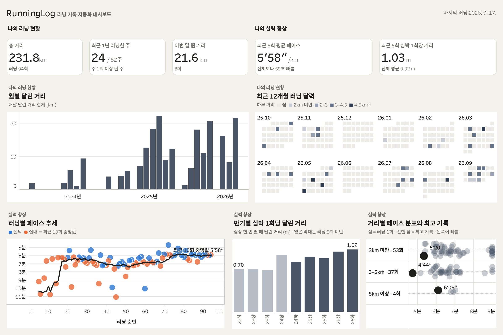

# 내 러닝 기록 대시보드

애플 피트니스(애플워치)에 쌓인 내 러닝 기록으로 "나는 예전에 비해 얼마나 더 잘 뛰는가"를 보여주는 대시보드 프로젝트입니다.

**대시보드 보기:** [Tableau Public – Running Log Dashboard](https://public.tableau.com/views/RunningLogDashboard/RunningLog)

[](https://public.tableau.com/views/RunningLogDashboard/RunningLog)

## 주요 발견 (2022-06 ~ 2026-10, 러닝 96회)

- **총 248.6km**를 달렸고, 기록 기간 52개월 중 29개월 동안 뛰었습니다.
- **2025년 6월부터 거의 매달** 뛰었습니다. 그 뒤로 쉰 달은 2025년 12월, 2026년 6월 두 번뿐입니다.
- **최근 5회 페이스가 전체보다 31초 빠릅니다.** 최근 5회 페이스 기준 6'24", 전체 6'55"입니다. 

## 대시보드로 답할 질문

1. **꾸준함**: 언제 많이 뛰었고 언제 쉬었나? 월별 거리는 어떻게 늘어났나?
2. **러닝 실력 향상**: 심박 거리, 페이스 추세로 보아 얼마나 실력이 늘었나?

## 데이터

- 출처
  - 아이폰 건강 앱 → "모든 건강 데이터 내보내기" (애플워치 + 나이키 런클럽 기록, 2022-06 ~ 2026-09)
  - 2026-10부터: 러닝이 끝날 때마다 아이폰 단축어가 남기는 러닝 파일 (애플워치 거리·심박 샘플)
- 원본 건강 데이터, 러닝 시작 시각, 경로(GPS)는 개인정보라 저장소와 대시보드에 올리지 않습니다.

### 정리 기준

| 기준 | 이유 |
|---|---|
| 1km당 12분 초과 기록 제외 | 걷기나 중간에 멈춘 기록이 섞여 있음 |
| 거리 0.5km 미만이거나 거리·시간이 없는 기록 제외 | 기록 오류 |
| 두 앱에 중복 기록된 러닝은 애플워치 기록만 사용 | 애플워치 기록에만 심박이 있음 |
| 단축어 기록과 내보내기 기록이 겹치면 단축어 기록만 사용 | 단축어 기록이 이미 시트에 올라가 있어 두 번 올라가지 않게 함 |

아침/저녁 비교와 기온 분석은 뺐습니다. 러닝 대부분이 저녁이고, 기온이 기록된 실외 러닝이 적어서입니다.

## 업데이트 구조

```
[평소] 애플워치로 달리기 → 아이폰 단축어가 러닝 파일을 iCloud Drive의 data/에 저장
[가끔] 아이폰 건강 앱 내보내기 → 맥으로 AirDrop (다운로드 폴더)
  → launchd가 data/나 다운로드 폴더 변화를 감지해 src/update.py --watch 실행
  → 러닝 계산·추출 → 정리
  → 구글 시트에 없는 기록ID만 추가 (월별 탭 재계산) → 전부 올라간 것을 확인하면 러닝 파일·zip 삭제
  → Tableau Public이 구글 시트를 하루 1번 동기화
```

### 아이폰 단축어

"모든 건강 데이터 내보내기"는 데이터가 쌓일수록 오래 걸려서, 평소에는 단축어 두 개로 방금 뛴 러닝만 보냅니다.

| 단축어 | 실행 시점 | 하는 일 |
|---|---|---|
| 러닝 시작 | 달리기 운동이 시작될 때 | 시작 시각을 `data/start.txt`에 저장 |
| 러닝 종료 | 달리기 운동이 종료될 때 | 실내/실외를 묻고, 종료 시각과 최근 하루치 애플워치 거리·심박 샘플을 `data/run.txt`에 저장 |

맥에서는 `src/shortcut_runs.py`가 시작~종료 사이의 샘플만 골라 거리는 더하고 심박은 평균을 내서 `data/shortcut_runs.csv`에 쌓습니다. 기록ID는 내보내기 기록과 같은 방식(시작 시각 + 기기)으로 만듭니다.

- 시간은 종료 - 시작이라 일시정지한 시간도 들어갑니다. 그래서 애플 기록보다 페이스가 조금 느리게 나올 수 있습니다.
- 실내/실외 질문에 답하지 않으면 파일이 저장되지 않습니다. 그 러닝은 다음 전체 내보내기 때 들어옵니다.
- 단축어 파일에는 기기 이름과 iCloud 폴더 정보가 들어 있어 저장소에 넣지 않았습니다.

심박이 없던 예전 나이키 런클럽 기록은 시트에 평균심박을 직접 채운 뒤, 처음 한 번만 `data/sheet_overrides.csv`로 가져왔습니다. 이후 기록은 애플워치가 심박을 남기므로 자동 업데이트에서는 시트 값을 가져오지 않습니다. 시트에 이미 있는 기록은 업로드 때 덮어쓰지 않기 때문에 직접 채운 값도 그대로 남습니다.

| 파일 | 역할 |
|---|---|
| `src/parse_runs.py` | 건강 데이터 zip → `data/runs.csv` (받아둔 평균심박 반영) |
| `src/shortcut_runs.py` | 단축어 러닝 파일 → `data/shortcut_runs.csv` |
| `src/clean_runs.py` | 두 CSV 합치기 + 정리 + 기록ID 부여 → `data/runs_clean.csv`, `data/monthly.csv` |
| `src/upload_sheet.py` | 시트에 없는 기록만 업로드하고, 전부 올라갔는지 확인 |
| `src/update.py` | 위 단계 실행 후 zip·러닝 파일 삭제 (`--watch`: 자동 실행용) |
| `src/sync_from_sheet.py` | (직접 실행할 때만) 시트에서 직접 채운 평균심박 → `data/sheet_overrides.csv` |
| `src/common.py` | 공통 경로, 기록ID, 시트 연결 함수 |
| `apps_script/Code.gs` | 구글 시트 쪽 웹 앱: 중복 거르기, 월별 요약 |
| `launchd/…plist` | 다운로드 폴더·`data/` 감시 설정 (개인정보로 업로드에서는 제외) |

직접 실행: `python src/update.py` (확인만: `--dry-run`)

## 도구

Python(pandas)으로 데이터 정리, Tableau Public으로 대시보드 제작
